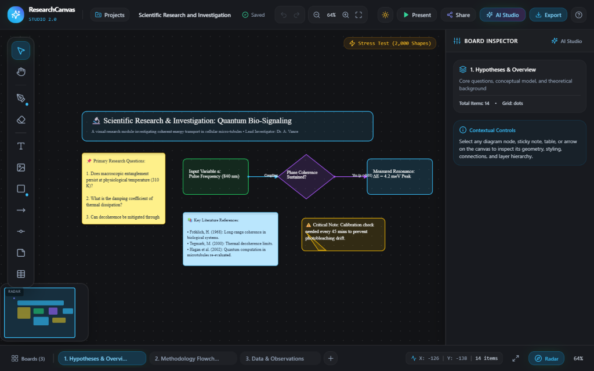

# ResearchCanvas — Visual Workspace & Diagramming Studio

> **A professional, high-performance infinite canvas application for visual research, diagramming, study modules, and presentations.**

ResearchCanvas is built with **React 18**, **TypeScript**, **Vite**, **Konva.js (react-konva)**, and **Tailwind CSS**. It provides an unlimited two-dimensional workspace where users can draw, write, insert images, assemble structured diagrams with magnetic connectors, structure research study cards, and present work.



---

## 🌟 Key Capabilities

### 1. High-Performance Infinite Canvas
- **Konva Vector Engine**: Smooth 60fps canvas interactions with sub-millisecond layer updates.
- **Viewport Culling**: Only elements intersecting the visible camera viewport (+200px margin) and connector endpoints are rendered, sustaining smooth navigation across thousands of elements.
- **Coordinate Space Transformation**: Accurate world-to-screen and screen-to-world transformations for pointer-centered zooming (10% to 500%) and freehand drawing.
- **Freehand Stroke Optimization**: Real-time distance throttling (1.5px world threshold) and post-stroke simplification using the **Ramer–Douglas–Peucker (RDP)** algorithm.
- **Dynamic Grid & MiniMap**: Level-of-Detail (LOD) dots/lines grid with an interactive radar minimap for spatial orientation.

### 2. Multi-Board Project Architecture
- **Independent Canvas Boards**: Create, rename, duplicate, and delete multiple boards per project (e.g., Overview, Methodology, Findings).
- **Decoupled Camera & Scene Graph**: Camera view (`x, y, zoom`) is managed in a separate store slice from the board elements, ensuring pan/zoom operations do not re-serialize or duplicate project state.
- **Per-Board In-Memory History**: Each board maintains its own undo/redo history stack (up to 50 steps) in memory, stripped before persistence to avoid storage bloat.

### 3. Diagramming & Object Management
- **Geometric Shapes**: Rectangles with rounded corners, Circles/Ellipses, Decision Diamonds, Polygons, and Annotation Callouts.
- **Smart Magnetic Connectors**: Directional connection arrows that attach to shape anchors (`top`, `right`, `bottom`, `left`) and automatically recalculate their path when connected shapes move or resize.
- **Connector Remapping**: Duplicating or copying a group of shapes and connectors preserves internal connectivity by automatically remapping endpoints to the new cloned shape IDs.
- **Data Tables & Research Sticky Notes**: Matrix tables with customizable rows, columns, and headers, alongside color-coded research cards.
- **Object Manipulation**: Marquee multi-selection, alignment (6 axes), distribution (horizontal/vertical), layer reordering (bring to front, send to back), locking, and live inspector geometry controls.
- **Internal Clipboard**: Full `Ctrl+C` (copy), `Ctrl+X` (cut), and `Ctrl+V` (paste with auto-offset) support for canvas elements, with automatic fallback to OS clipboard for external image pastes.

### 4. AI Studio Assistant
- **Real LLM Integration**: Connects to the **Google Gemini API** (`gemini-1.5-flash`) or any **OpenAI-compatible** endpoint (`/chat/completions`) using the user's own API key.
- **Schema Validation**: All LLM outputs are validated against strict **Zod schemas** ensuring correct nodes, labels, dimensions, and edge indices before rendering.
- **Local Security**: API keys are stored exclusively in the browser's `localStorage` (`research_canvas_api_key`) and are **never** bundled into project JSON files or exported data.
- **Offline Generative Mode**: When no API key is configured, ResearchCanvas uses its built-in offline template generator to synthesize editable mind maps, flowcharts, and study cards.
- **Safe Review & Insertion**: AI-generated diagrams require user preview and explicit confirmation before insertion onto the active board, guaranteeing existing elements are never overwritten.

### 5. Multi-Tier Persistence & Image Store
- **IndexedDB Image Store**: Pasted and dropped images are stored in IndexedDB via the `idb` library, referencing them via lightweight `imageId` handles to prevent JSON storage quota exhaustion.
- **Isolated Per-Project Persistence**: Each project is stored under its own key (`research_proj_<id>`) alongside an atomic project index (`research_canvas_projects_index_v2`).
- **Debounced Autosave**: Automatic 400ms debounced saving with visual state badges (`Saved`, `Saving...`, `Save failed`) and explicit `beforeunload` flushing.
- **Self-Contained JSON Portability**: JSON export embeds all referenced IndexedDB images as base64 data URLs for seamless cross-machine sharing, while JSON import safely extracts and restores them into IndexedDB.

---

## ⌨️ Complete Keyboard Shortcuts Reference

| Shortcut | Action | Description |
| :--- | :--- | :--- |
| **V** | Select Tool | Default pointer tool for selecting, dragging, and resizing elements |
| **H** | Hand Tool | Pan canvas by clicking and dragging |
| **Space + Drag** | Quick Pan | Temporarily activate pan from any tool |
| **Mouse Wheel** | Zoom In / Out | Smooth pointer-centered zooming |
| **R** | Rectangle | Create rectangle shapes |
| **O** | Circle | Create circle / ellipse shapes |
| **D** | Diamond | Create decision diamond nodes |
| **A** | Arrow | Create directional arrows |
| **L** | Line | Create straight connector lines |
| **P** | Pencil | Freehand pen, pencil, marker, or highlighter |
| **T** | Text | Add editable typography and headers |
| **S** | Sticky Note | Create research sticky note cards |
| **Ctrl + C** | Copy Elements | Copy selected elements to internal memory clipboard |
| **Ctrl + X** | Cut Elements | Cut selected elements to internal memory clipboard |
| **Ctrl + V** | Paste | Paste copied canvas elements (or pasted image from OS clipboard) |
| **Ctrl + A** | Select All | Select all elements on the active board |
| **Ctrl + D** | Duplicate | Duplicate selected elements with connector endpoint remapping |
| **Arrow Keys** | Nudge (1px) | Move selected elements by 1 world unit |
| **Shift + Arrows** | Nudge (10px) | Move selected elements by 10 world units |
| **Ctrl + Z** | Undo | Undo the last action (board-specific) |
| **Ctrl + Y** | Redo | Redo the previously undone action |
| **Del / Backspace** | Delete | Remove selected elements from the canvas |
| **Esc** | Cancel / Deselect | Deselect all elements and return to Select tool |
| **?** | Shortcuts Help | Open the keyboard shortcuts modal |

---

## 📁 Project Architecture & Structure

```
ResearchCanvas/
├── electron/                   # Electron desktop packaging layer
│   ├── main.cjs                # Main process lifecycle and native dialog handlers
│   └── preload.cjs             # Secure contextBridge exposure (window.electronAPI)
├── src/
│   ├── components/
│   │   ├── canvas/             # Konva canvas rendering engine
│   │   │   ├── elements/       # Memoized element renderers (Rect, Circle, Connector, etc.)
│   │   │   ├── CanvasStage.tsx # Main Konva Stage with culling, event handlers, and pan/zoom
│   │   │   └── InlineTextEditor.tsx # In-place text editing overlay
│   │   ├── common/
│   │   │   └── ErrorBoundary.tsx # Catch-all recovery screen with backup export
│   │   └── ui/                 # Application workspace UI
│   │       ├── TopBar.tsx      # Project title, zoom, undo/redo, theme, and export menu
│   │       ├── LeftToolbar.tsx # Primary tools and flyouts (pen, shapes, sticky, table)
│   │       ├── RightInspector.tsx # Property controls (geometry, styling, align, distribute)
│   │       ├── BottomBar.tsx   # Multi-board tabs, board actions, and minimap toggle
│   │       ├── MiniMap.tsx     # Spatial overview radar
│   │       ├── AiStudioPanel.tsx # AI Studio with Gemini/OpenAI configuration and preview
│   │       ├── ProjectsDashboard.tsx # Project manager and switching modal
│   │       ├── ShareModal.tsx  # Export & share project modal
│   │       ├── ToastContainer.tsx # Lightweight non-blocking notifications
│   │       └── ConfirmModal.tsx # Confirmation dialog for destructive operations
│   ├── data/
│   │   └── sampleProject.ts    # Built-in research template project
│   ├── hooks/
│   │   └── useKeyboardShortcuts.ts # Centralized keyboard shortcut router
│   ├── services/
│   │   ├── aiService.ts        # Gemini and OpenAI API client with Zod schema validation
│   │   └── imageStore.ts       # IndexedDB image persistence service
│   ├── store/
│   │   ├── useCanvasStore.ts   # Zustand state store with decoupled camera and debounced saves
│   │   └── useToastStore.ts    # Global toast and modal confirmation store
│   ├── types/
│   │   ├── canvas.ts           # Core element, board, project, and camera type definitions
│   │   └── global.d.ts         # Window.electronAPI ambient declarations
│   └── utils/
│       ├── geometry.ts         # Coordinate math, bounding boxes, and intersection tests
│       ├── id.ts               # Unique collision-free ID generation
│       ├── migration.ts        # Schema v2 upgrade and board sanitization
│       ├── export.ts           # Retina PNG and self-contained JSON export/import
│       └── strokeSimplifier.ts # Ramer–Douglas–Peucker polyline simplification
├── tests/                      # Automated test suite (Vitest + JSDOM)
│   ├── geometry.test.ts        # Geometry, bounding boxes, and RDP tests
│   ├── history.test.ts         # Undo/redo stack depth and state rollback tests
│   ├── migration.test.ts       # Schema v2 migration tests
│   ├── persistence.test.ts     # Project storage and imageStore tests
│   └── remapping.test.ts       # Connector duplication endpoint remapping tests
├── package.json
├── tsconfig.json
├── vite.config.ts
└── vitest.config.ts
```

---

## 🛠️ Getting Started & Development

### Prerequisites
- **Node.js**: v18.0.0 or higher (v20+ LTS recommended)
- **npm** or **pnpm**

### Installation
```bash
git clone https://github.com/your-org/ResearchCanvas.git
cd ResearchCanvas
npm install
```

### Running the Web Dev Server
```bash
npm run dev
```
Navigate to `http://localhost:3000` in your browser.

### Running Automated Tests
```bash
npm test
```
Executes the Vitest test suite verifying geometry, schema migration, connector remapping, history stacks, and persistence.

### Production Build & Type Checking
```bash
npm run build
```
Runs TypeScript (`tsc`) in strict mode and builds the optimized production bundle with Vite.

---

## 🖥️ Desktop Application Packaging (Electron)

ResearchCanvas includes a dedicated desktop shell with native file system save and open dialogs:

### Running Desktop Development Mode
```bash
npm run electron:dev
```
Starts Vite dev server and launches Electron concurrently with live reloading.

### Building Desktop Installers
```bash
# Build desktop application for current platform:
npm run electron:build

# Specific platform targets:
npx electron-builder --win   # Windows installer (.exe)
npx electron-builder --mac   # macOS disk image (.dmg) [requires macOS host]
npx electron-builder --linux # Linux package (.AppImage)
```
Outputs installer bundles to the `dist-electron/` directory.

---

## 🌐 Browser Support & Limitations

### Browser Compatibility
- **Google Chrome / Chromium**: Fully supported (v90+)
- **Mozilla Firefox**: Fully supported (v95+)
- **Apple Safari**: Fully supported (v15+)
- **Microsoft Edge**: Fully supported (v90+)

### Current Limitations
- **Cloud Real-Time Collaboration**: Real-time multi-user cursor presence (via WebSockets/CRDTs) is not yet active; collaboration is currently supported via self-contained JSON project export/import.
- **Hardware Acceleration**: Smooth 60fps performance with 2,000+ objects depends on hardware-accelerated 2D canvas support enabled in your browser settings.
- **Touch Gestures**: While mouse, trackpad, and stylus devices are supported, multi-touch pinch-to-zoom is currently optimized for trackpads and pointer wheel events.
